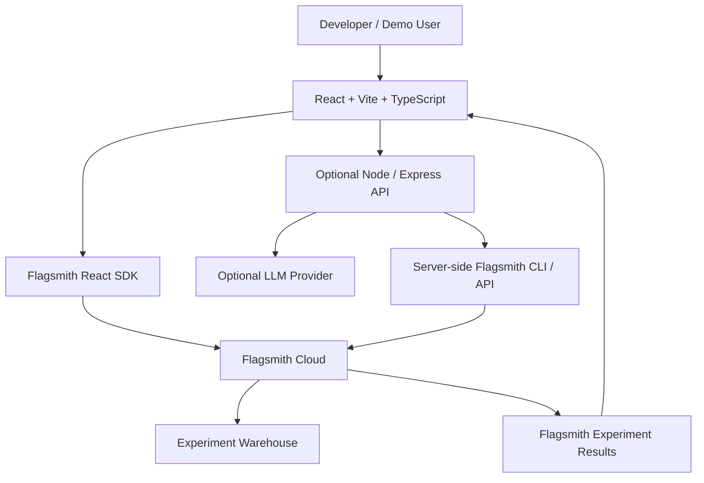

# Technical Architecture

## Initial architecture

## Architecture decision

Keep the first vertical slice as small as possible:
- Frontend uses Flagsmith SDK for flag evaluation, experiment exposure and conversion events.
- Add Express only when server-side LLM calls or privileged configuration operations are actually required.
- Never put admin keys in frontend.
- Do not add PostgreSQL until we need to persist app-specific users, saved plans or history.

## Frontend areas

- `features/copilot`: experiment intake and plan editor.
- `features/experiments`: lifecycle and configuration screens.
- `features/playground`: CTA variant and genuine demo completion.
- `features/results`: Flagsmith result presentation.
- `lib/flagsmith`: SDK setup and identity helper.
- `components`: layout and reusable UI.

## Backend areas (optional)

- `routes`: validated HTTP endpoints.
- `services/llm`: LLM provider adapter.
- `services/flagsmith`: privileged integration adapter.
- `schemas`: Zod input/output contracts.
- `middleware`: error, rate limit and auth controls.

## Data flows

### Plan
Input → schema validation → deterministic plan (or optional LLM) → schema validation → user edits → approval.

### Flagsmith configuration
Prerequisite check → dry-run preview → user approves create/configure → verify resource IDs and keyed variants → separate approval to start → verify running status.

### Exposure/conversion
Initialise SDK with events enabled → identify stable anonymous visitor → obtain experiment flag where user sees it → render variant → send conversion at actual completion → flush buffered events.

### Results
Read from documented Flagsmith results interface → render only returned data → collecting/inconclusive where evidence is insufficient.

## Critical Flagsmith behaviour

- Experimentation uses remote evaluation.
- Users must be identified.
- Exposure and conversion are joined by identity.
- `useExperiment` records exposure when the component renders.
- If evaluating earlier than actual display, use documented non-exposure evaluation and record exposure at display.
- Exact API/method details must come from current official docs.

## Security

Public client environment key only in frontend. Server/admin credentials and LLM credentials stay server-side. Validate all inputs and model outputs. Require explicit human approval for privileged operations.
